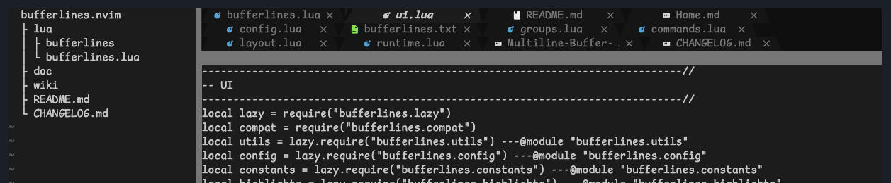
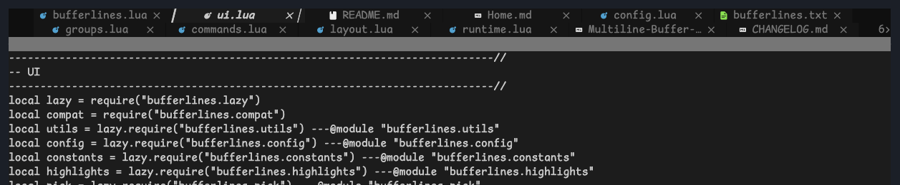
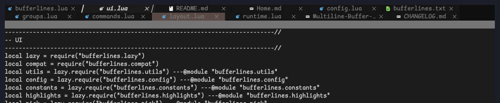
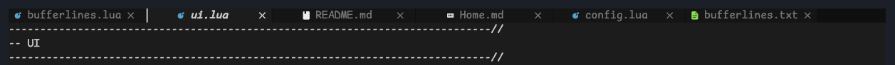
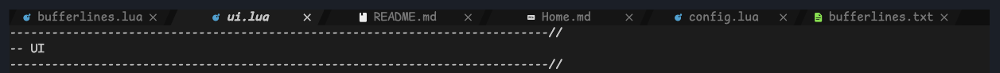
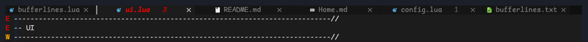
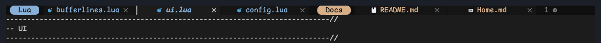
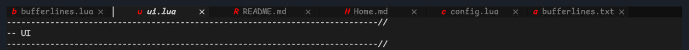

<h1 align="center">bufferlines.nvim</h1>

<p align="center">
  A snazzy buffer line for Neovim that wraps your open buffers into <b>multiple rows</b>
  instead of hiding them.
</p>

<p align="center">
  <a href="https://github.com/D0n9X1n/bufferlines.nvim/actions/workflows/ci.yml"></a>
  <a href="https://github.com/D0n9X1n/bufferlines.nvim/releases/latest"></a>
  
  <a href="LICENSE"></a>
</p>

<p align="center">
  <a href="https://github.com/D0n9X1n/bufferlines.nvim/wiki/Home">Wiki</a> ·
  <a href="README.zh-CN.md">中文说明</a>
</p>



## Multiline buffer tabs

Twelve buffers, no `<` `>` scrolling: the opt-in multiline header wraps every tab to the
editor's width and leaves full-height sidebars alone.

- **Adaptive rows** — grows up to `max_rows`; a counter and the mouse wheel reach the rest.

  

- **Keyboard and mouse** — move a highlight across rows and confirm with `<CR>`, or click.

  

- **Same styling** — icons, diagnostics, groups, pins and separators work on every row.

Multiline is opt-in and needs **Neovim 0.12+**. Leave it out and you get the classic
single-row bufferline, still the default, on Neovim 0.8+.

## Installation

With [lazy.nvim](https://github.com/folke/lazy.nvim):

```lua
{
  "D0n9X1n/bufferlines.nvim",
  version = "*",
  dependencies = { "nvim-tree/nvim-web-devicons" },
  config = function()
    vim.opt.termguicolors = true
    require("bufferlines").setup({
      options = {
        multiline = { enabled = true, max_rows = 3 }, -- Neovim 0.12+; omit for one row
      },
    })
  end,
}
```

You need `termguicolors` and a [Nerd Font](https://github.com/ryanoasis/nerd-fonts). Other
plugin managers: [Installation and Usage](https://github.com/D0n9X1n/bufferlines.nvim/wiki/Installation-and-Usage).

## Features

**Default**



**Sloped separators**



**LSP diagnostics**



**Groups**



**Picking**



**Hover to reveal**


Also: tabpages mode, sidebar offsets, numbers, unique names, pinning, re-ordering with
persisted order, custom areas and colours derived from your colorscheme. Each one has a
screenshot in [Features](https://github.com/D0n9X1n/bufferlines.nvim/wiki/Features).

## Migrating from bufferline.nvim

Every public name gains an `s`: `require("bufferlines")`, `:BufferLines*` commands and
`BufferLines*` highlights. The look is unchanged and saved buffer order is read once from
the old keys. Replace the old plugin; both cannot be installed at once. Full table:
[Installation and Usage](https://github.com/D0n9X1n/bufferlines.nvim/wiki/Installation-and-Usage).

## Documentation

- [Multiline Buffer Tabs](https://github.com/D0n9X1n/bufferlines.nvim/wiki/Multiline-Buffer-Tabs)
  — settings, keys and limitations, or `:help bufferlines-multiline`
- [Configuration](https://github.com/D0n9X1n/bufferlines.nvim/wiki/Configuration)
  — every option, or `:help bufferlines-configuration`
- [FAQ and Caveats](https://github.com/D0n9X1n/bufferlines.nvim/wiki/FAQ-and-Caveats)
- [Testing and Development](https://github.com/D0n9X1n/bufferlines.nvim/wiki/Testing-and-Development)
  and [AGENTS.md](AGENTS.md) for contributors and AI coding agents

## Acknowledgements

bufferlines.nvim is a fork of [akinsho/bufferline.nvim](https://github.com/akinsho/bufferline.nvim)
by Akin Sowemimo and contributors. Thank you for years of work on the plugin this one is
built on. Its look was inspired by DOOM Emacs and
[centaur tabs](https://github.com/ema2159/centaur-tabs).

## License

[GPL-3.0](LICENSE), as inherited from bufferline.nvim.
