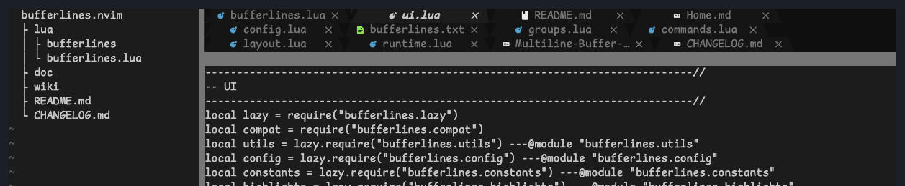
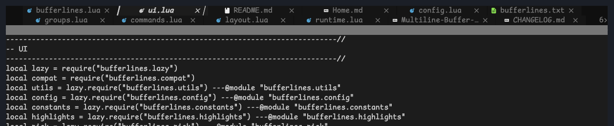
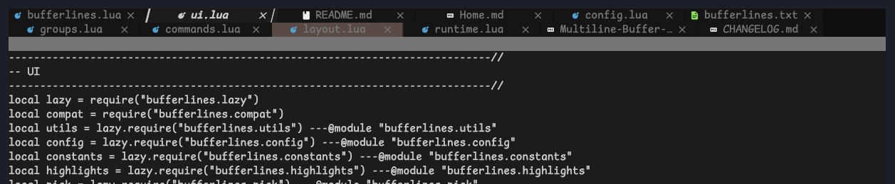
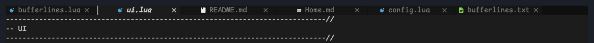
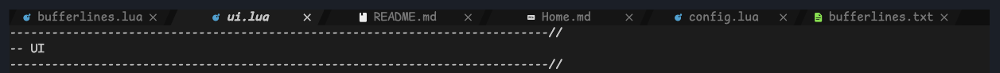
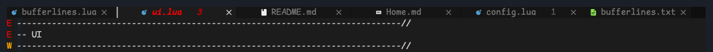
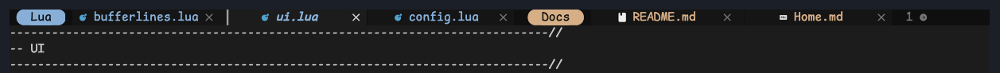
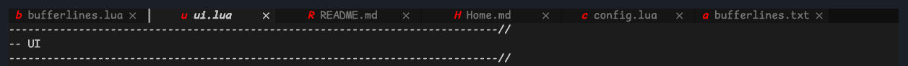

<h1 align="center">bufferlines.nvim</h1>

<p align="center">
  一个时髦的 Neovim buffer 行：把打开的 buffer 自动换行成<b>多行</b>显示，而不是把它们藏起来。
</p>

<p align="center">
  <a href="https://github.com/D0n9X1n/bufferlines.nvim/actions/workflows/ci.yml"></a>
  <a href="https://github.com/D0n9X1n/bufferlines.nvim/releases/latest"></a>
  
  <a href="LICENSE"></a>
</p>

<p align="center">
  <a href="https://github.com/D0n9X1n/bufferlines.nvim/wiki/Home-zh-CN">中文 Wiki</a> ·
  <a href="README.md">English</a>
</p>



## 多行 buffer 标签

打开十二个 buffer 也无需 `<` `>` 来回滚动：可选启用的多行标题栏会按编辑区宽度把所有标签自动换行，
同时不影响全高侧边栏。

- **自适应行数**——最多增长到 `max_rows` 行；其余的行通过计数器和鼠标滚轮查看。

  

- **键盘与鼠标**——在各行之间移动高亮并按 `<CR>` 确认，或直接点击。

  

- **样式一致**——图标、诊断、分组、固定与分隔符在每一行都能使用。

多行模式需手动启用，并要求 **Neovim 0.12+**。不启用时就是经典的单行 bufferline，它仍是默认渲染器，
支持 Neovim 0.8+。

## 安装

使用 [lazy.nvim](https://github.com/folke/lazy.nvim)：

```lua
{
  "D0n9X1n/bufferlines.nvim",
  version = "*",
  dependencies = { "nvim-tree/nvim-web-devicons" },
  config = function()
    vim.opt.termguicolors = true
    require("bufferlines").setup({
      options = {
        multiline = { enabled = true, max_rows = 3 }, -- Neovim 0.12+; omit for one row
      },
    })
  end,
}
```

需要开启 `termguicolors` 并使用 [Nerd Font](https://github.com/ryanoasis/nerd-fonts)。其他插件管理器参见
[安装与使用](https://github.com/D0n9X1n/bufferlines.nvim/wiki/Installation-and-Usage-zh-CN)。

## 功能

**默认样式**



**倾斜分隔符**



**LSP 诊断**



**分组**



**拾取**



**悬停显示**


另外还有：标签页模式、侧边栏偏移、编号、唯一名称、固定、可持久化的重新排序、自定义区域，以及从配色方案
取色。每项功能的截图见[功能](https://github.com/D0n9X1n/bufferlines.nvim/wiki/Features-zh-CN)。

## 从 bufferline.nvim 迁移

所有公开名称都加上 `s`：`require("bufferlines")`、`:BufferLines*` 命令和 `BufferLines*` 高亮组。
外观不变，已保存的 buffer 顺序会从旧键读取一次。请替换旧插件，二者不能同时安装。完整对照表见
[安装与使用](https://github.com/D0n9X1n/bufferlines.nvim/wiki/Installation-and-Usage-zh-CN)。

## 文档

- [多行 buffer 标签](https://github.com/D0n9X1n/bufferlines.nvim/wiki/Multiline-Buffer-Tabs-zh-CN)
  ——设置、按键与限制，或 `:help bufferlines-multiline`
- [配置](https://github.com/D0n9X1n/bufferlines.nvim/wiki/Configuration-zh-CN)
  ——全部选项，或 `:help bufferlines-configuration`
- [常见问题与注意事项](https://github.com/D0n9X1n/bufferlines.nvim/wiki/FAQ-and-Caveats-zh-CN)
- [测试与开发](https://github.com/D0n9X1n/bufferlines.nvim/wiki/Testing-and-Development-zh-CN)
  以及面向贡献者和 AI 编程助手的 [AGENTS.md](AGENTS.md)

## 致谢

bufferlines.nvim 是 Akin Sowemimo 及贡献者开发的
[akinsho/bufferline.nvim](https://github.com/akinsho/bufferline.nvim) 的分支。感谢他们多年来对原插件的
投入，本项目正是在其基础上构建的。其外观灵感来自 DOOM Emacs 和
[centaur tabs](https://github.com/ema2159/centaur-tabs)。

## 许可证

[GPL-3.0](LICENSE)，继承自 bufferline.nvim。
