# 功能

[English](Features)

- 尽可能从配色方案中取色。
- 按 `extension`、`directory` 或自定义比较函数对 buffer 排序。
- 通过 Lua 函数配置，获得更高的自定义程度。

另见：[多行 buffer 标签](Multiline-Buffer-Tabs-zh-CN)。

## 其他样式

### 斜切标签

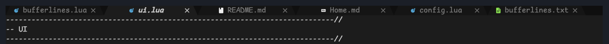

**注意**：某些终端需要对特殊字符做额外填充，若在你的终端模拟器中显示不正确，请将样式设为
`padded_slant`。效果因终端模拟器而异，该样式可能并非在所有终端下都可用。

### 倾斜标签

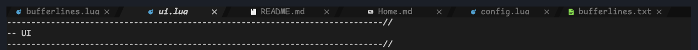

参见 `:help bufferlines-styling`。

## 悬停事件

**注意**：仅在 Neovim 0.8+ 可用。[多行模式](Multiline-Buffer-Tabs-zh-CN)不支持该功能。

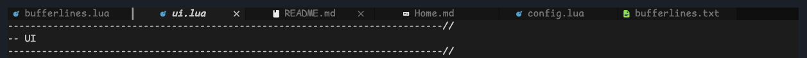

参见 `:help bufferlines-hover-events`。

## 下划线指示器

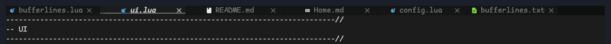

设置 `indicator = { style = "underline" }`。下划线的效果取决于终端模拟器对下划线的支持。

## 标签页

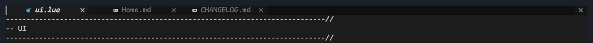

将 `mode` 选项设为 `tabs` 可以只显示标签页。这会把 bufferlines 变成一个 tabline，保留了大部分
（但不是全部）功能与样式：

- 排序尚不可用，这部分仍需仔细设计。
- 分组同样尚不可用，原因相同。

多行模式不支持 `mode = "tabs"`。

## LSP 指示器

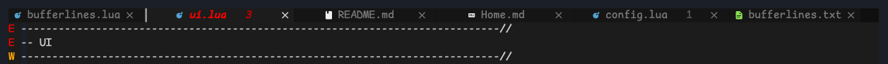

设置 `diagnostics = "nvim_lsp" | "coc"` 后，任何存在错误的 buffer 都会显示指示器，让你一眼看出
哪些 buffer 受影响。

用函数自定义计数的呈现方式：

```lua
--- count is an integer representing total count of errors
--- level is a string "error" | "warning"
--- diagnostics_dict is a dictionary from error level ("error", "warning" or "info") to number of errors for each level.
--- this should return a string
--- Don't get too fancy as this function will be executed a lot
diagnostics_indicator = function(count, level, diagnostics_dict, context)
  local icon = level:match("error") and " " or " "
  return " " .. icon .. count
end
```

```lua
diagnostics_indicator = function(count, level, diagnostics_dict, context)
  local s = " "
  for e, n in pairs(diagnostics_dict) do
    local sym = e == "error" and " "
      or (e == "warning" and " " or " ")
    s = s .. n .. sym
  end
  return s
end
```

也可以根据 buffer 上下文有条件地显示指示器。例如对当前 buffer 关闭指示，只为其他 buffer 显示：

```lua
diagnostics_indicator = function(count, level, diagnostics_dict, context)
  if context.buffer:current() then
    return ''
  end

  return ''
end
```

错误状态下文件名的高亮可通过 `:help bufferlines-highlights` 调整。

## 分组

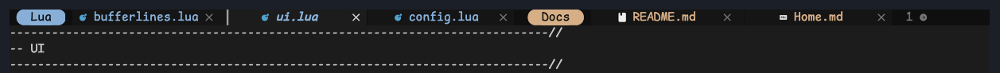

分组把相关的 buffer 聚成一簇，并允许对它们整体操作——例如点击分组指示器可隐藏该组全部 buffer。
其灵感部分来自 Chrome 的标签页以及 centaur-tabs 的分组。

参见 `:help bufferlines-groups`。

## 侧边栏偏移

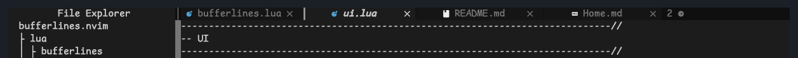

参见 `:help bufferlines-sidebar-offset`。偏移仅作用于原生 tabline；多行模式使用其编辑分割窗口的
实际宽度。

## 编号

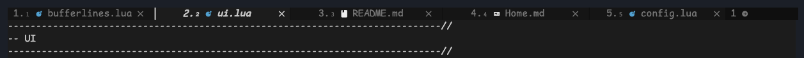

使用 `numbers` 选项可为 buffer 名称添加 `ordinal` 或 `buffer id` 前缀，取值为 `buffer_id`、
`ordinal` 或一个函数。

参见 `:help bufferlines-numbers`。

## 唯一名称

文件名相同的 buffer 会加上足以区分它们的路径前缀。

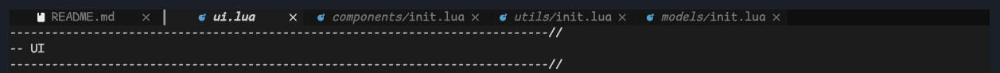

## 关闭图标

每个 buffer 都有关闭图标；已修改的 buffer 显示圆点。`show_close_icon` 会在 tabline 右端添加关闭按钮。

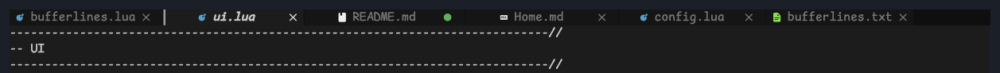

## 重新排序

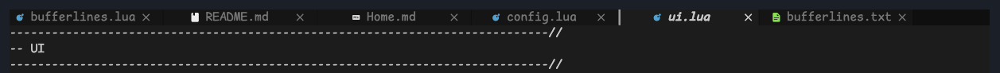

用 `:BufferLinesMoveNext` / `:BufferLinesMovePrev` 移动 buffer。该顺序可以跨会话保持（默认启用）。

## 拾取

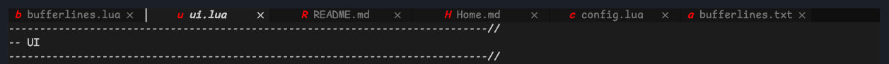

参见 `:help bufferlines-pick`。

## 固定

`:BufferLinesTogglePin` 把 buffer 固定在最前，并显示图钉图标。固定功能使用内置的 `pinned` 分组。

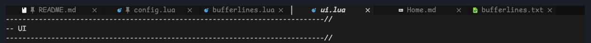

## 自定义区域

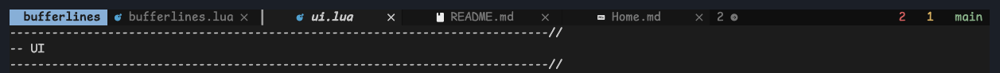

参见 `:help bufferlines-custom-areas`。自定义区域仅限单行模式，多行模式不支持。
