# Features

[简体中文](Features-zh-CN)

- Colours derived from the colorscheme where possible.
- Sort buffers by `extension`, `directory`, or a custom compare function.
- Configuration via Lua functions for greater customization.

See also: [Multiline Buffer Tabs](Multiline-Buffer-Tabs).

## Alternate styling

### Slanted tabs

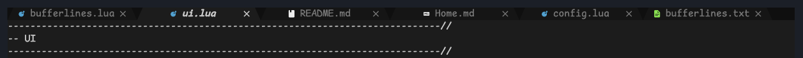

**NOTE**: some terminals require special characters to be padded, so set the style to
`padded_slant` if the appearance isn't right in your terminal emulator. Results vary by
terminal emulator and this style might not work everywhere.

### Sloped tabs

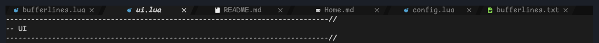

See `:help bufferlines-styling`.

## Hover events

**NOTE**: only available for Neovim 0.8+. Not supported with
[multiline](Multiline-Buffer-Tabs).

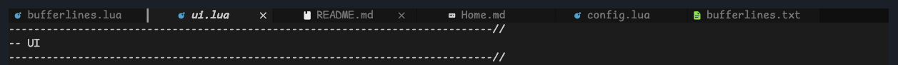

See `:help bufferlines-hover-events`.

## Underline indicator

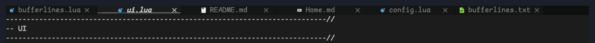

Set `indicator = { style = "underline" }`. How the underline looks depends on your
terminal emulator's underline support.

## Tabpages

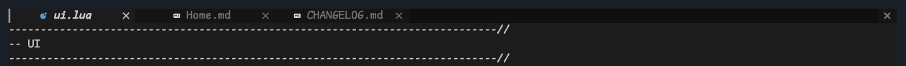

Set the `mode` option to `tabs` to show only tabpages. This turns the bufferlines into a
tabline with many of the same features and styling, but not all:

- Sorting doesn't work yet, as that needs to be thought through.
- Grouping doesn't work yet, for the same reason.

`mode = "tabs"` is not supported with multiline.

## LSP indicators

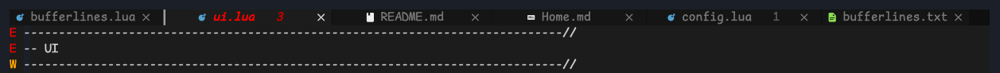

Setting `diagnostics = "nvim_lsp" | "coc"` adds an indicator for any buffer with errors,
so you can tell at a glance which buffers are affected.

Customise the appearance of the count with a function:

```lua
--- count is an integer representing total count of errors
--- level is a string "error" | "warning"
--- diagnostics_dict is a dictionary from error level ("error", "warning" or "info") to number of errors for each level.
--- this should return a string
--- Don't get too fancy as this function will be executed a lot
diagnostics_indicator = function(count, level, diagnostics_dict, context)
  local icon = level:match("error") and " " or " "
  return " " .. icon .. count
end
```

```lua
diagnostics_indicator = function(count, level, diagnostics_dict, context)
  local s = " "
  for e, n in pairs(diagnostics_dict) do
    local sym = e == "error" and " "
      or (e == "warning" and " " or " ")
    s = s .. n .. sym
  end
  return s
end
```

Indicators can be reported conditionally, based on buffer context. For instance, disable
them for the current buffer and show them only for other buffers:

```lua
diagnostics_indicator = function(count, level, diagnostics_dict, context)
  if context.buffer:current() then
    return ''
  end

  return ''
end
```

Change the filename highlighting for error states via `:help bufferlines-highlights`.

## Groups

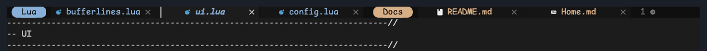

Groups visualize related buffers in clusters and let you operate on them together — for
example, clicking the group indicator hides all its buffers. Partly inspired by Chrome's
tabs and centaur-tabs' groups.

See `:help bufferlines-groups`.

## Sidebar offsets

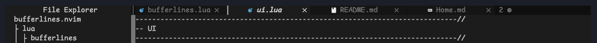

See `:help bufferlines-sidebar-offset`. Offsets apply to the native tabline only;
multiline uses its editor split's actual width.

## Numbers

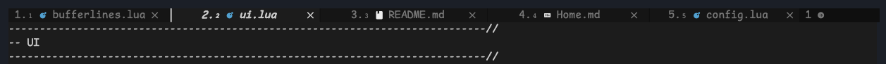

Prefix buffer names with either the `ordinal` or `buffer id` using the `numbers` option,
specified as `buffer_id` | `ordinal` or a function.

See `:help bufferlines-numbers`.

## Unique names

Buffers with the same file name are prefixed with just enough of their path to tell them
apart.

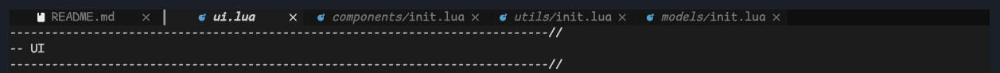

## Close icons

Each buffer has a close icon; a modified buffer shows a dot instead. `show_close_icon` adds
a close button at the right end of the tabline.

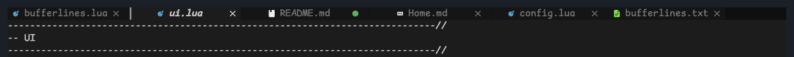

## Re-ordering

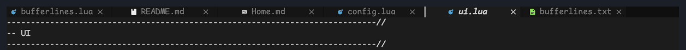

Move buffers with `:BufferLinesMoveNext` / `:BufferLinesMovePrev`. This order can be
persisted between sessions (enabled by default).

## Picking

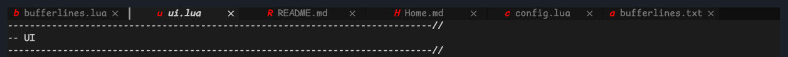

See `:help bufferlines-pick`.

## Pinning

`:BufferLinesTogglePin` keeps a buffer at the front with a pin icon. Pins use the built-in
`pinned` group.

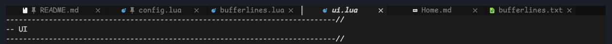

## Custom areas

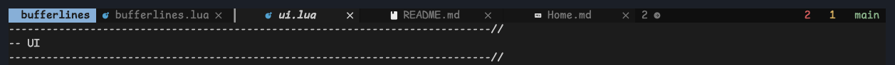

See `:help bufferlines-custom-areas`. Custom areas are single-row only and are not
supported with multiline.
